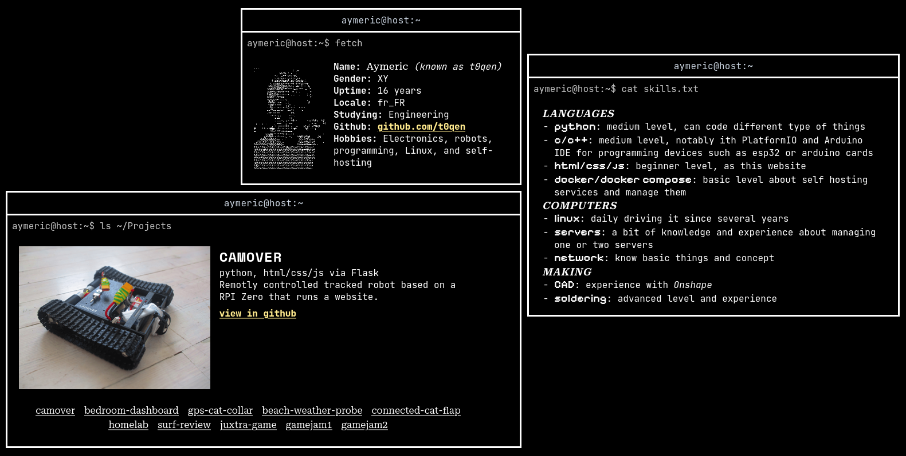
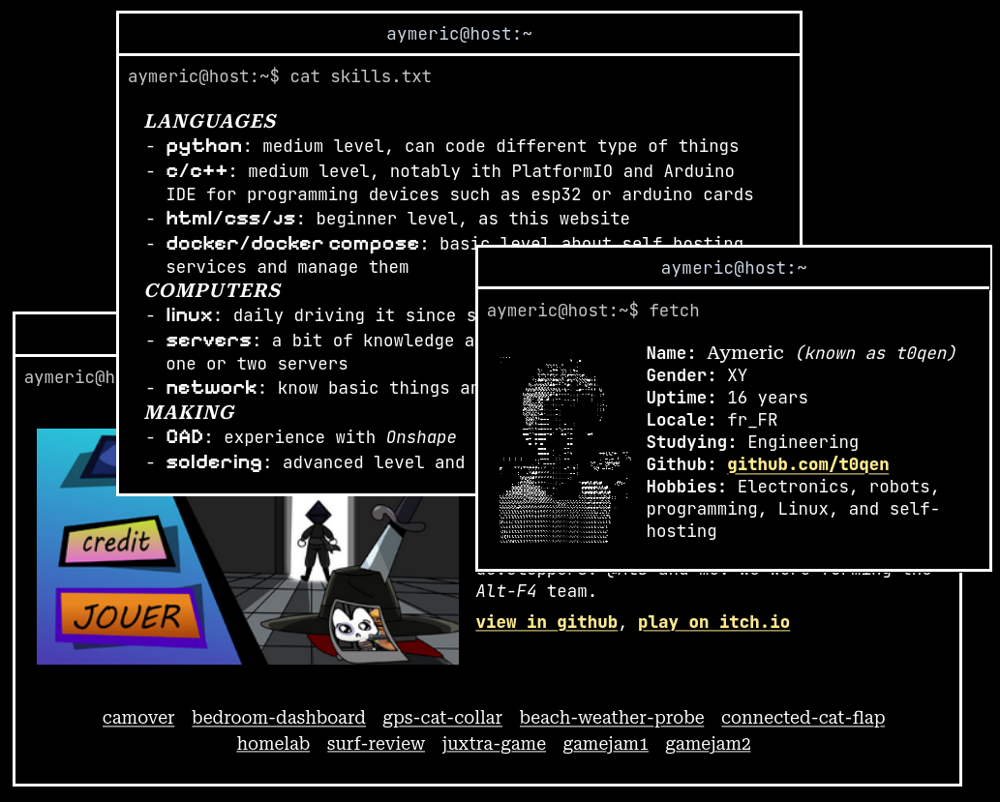
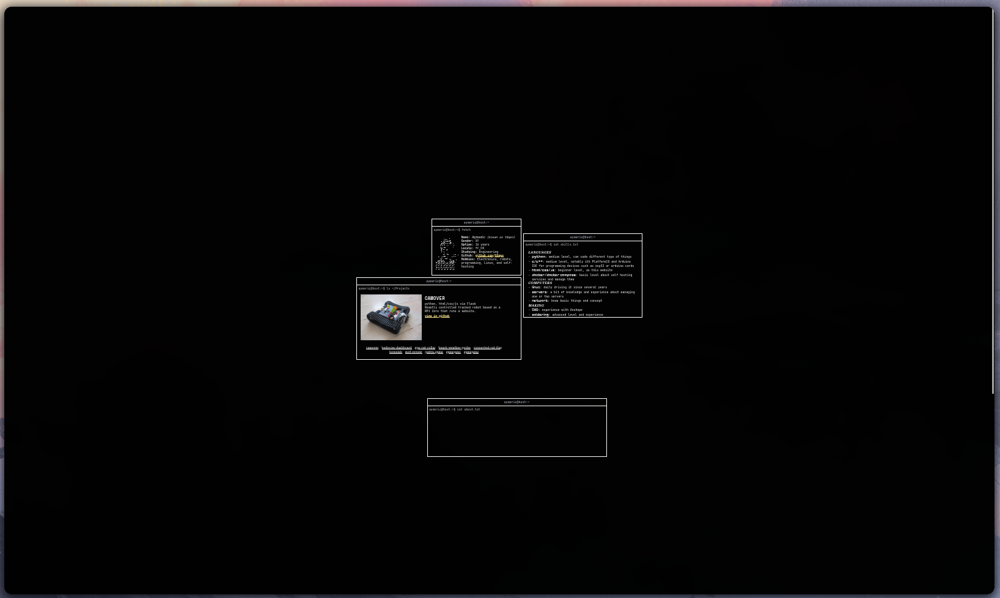

  ### my very own **portfolio** 💾️
  My personal website acting as my résumé, showing my projects, skills, and personal infos

  [features](#features)  - [how it's done](#hiw) - [about](#about) - [screenshots](#screenshots)

---------------

### ✅️ features 
- floating windows manager like thought javascript and css
- shows skills, projects, personal infos, etc
- monochrome theme
- custom fonts
- scrollable to see more windows
- (planned) better phone support

### 💻️ how it's done 
It's vanilla html/css/js code, without the help of any framework.

### ✏️ about 
**Responsive design**

I hadn't the level and the patience to create a natural rasponsive design so instead of make something bad visually I just set everything to a fixed size in pixel and made possible to zoom/dezoom.

**Why did I made this ?**

To quickly introduce myself on the internet and share my works and my skills. After more dev and polish it might even be showed to a future employer.

### 📷️ screenshots 

